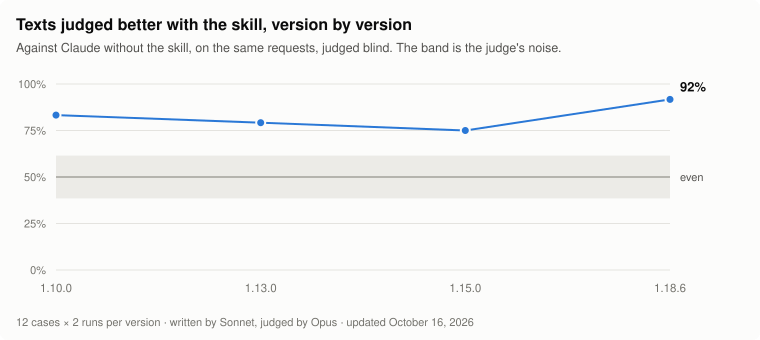

<div align="center">


# Italian master

**Your agent already writes Italian.<br>With Italian master it writes it like a professional.**

An agent skill for Claude, Codex and other Agent Skills-compatible agents, built on more than five million Italian words that were read and measured.

[](CHANGELOG.md)
[](https://github.com/micheledalsanto/italian-master/actions/workflows/tests.yml)
[](LICENSE)
<br>
[](#claude-code-as-a-plugin)
[](#codex-and-other-agents)
[](#every-way-to-install-it)
[](#sources-and-limits)
<br>
[](#try-it-now)
[](#the-command-line-checker)
[](https://github.com/micheledalsanto/italian-master/stargazers)

[Try it now](#try-it-now) · [One email, three times](#one-email-written-three-times) · [What it can do](#ask-it-what-you-would-ask-an-editor) · [Tested](#tested-against-claude-on-its-own) · [Installation](#every-way-to-install-it) · [Italiano](README.md)

</div>

*The skill itself, its reference files and the changelog are written in Italian. [Leggi questo README in italiano](README.md).*

## Correct, and still fake

Ask a language model for a text in Italian and you will almost always get a page with no mistakes that no Italian would have written. It opens on a world that is «sempre più connesso», uses three adjectives where one would do, capitalises every word of the headline and borrows the em dash from English. Ask it to be more concise and it falls into the opposite flaw, answering in five-word sentences closed by a punchline, which are just as easy to spot as generated.

Italian master gives the model what a good Italian editor learns over years of work: where grammar really goes wrong, how to build a sentence that does not sound translated, when to use *tu*, *lei* or *voi*, how to write a headline and which verb tense a story needs. Above all, it teaches the model to work with the facts it is given, without inventing new ones to fill the page.

## One email, written three times

All three texts answer the same request: an email in which a professional firm tells its clients that the office is closed from 11 to 24 August, asks anyone with deadlines in that period to get in touch by 31 July, and names Paola, on her mobile, as the contact for urgent matters.

**The model on its own**

> **Oggetto: Aggiornamento Importante Sulla Nostra Chiusura Estiva**
>
> Gentile Cliente,
>
> speriamo che questa email ti trovi bene! In un periodo dell'anno in cui il riposo diventa fondamentale, desideriamo informarLa che il nostro team si prenderà una meritata pausa — per tornare più carico che mai. Non si tratta solo di una chiusura: è un'occasione per ricaricare le energie, rinnovarci e offrirti un servizio ancora migliore.

**The model on its own, asked to be more concise**

> **Oggetto: Ad agosto chiudiamo. Ecco cosa cambia.**
>
> Chiudiamo. Due settimane. Dall'11 al 24 agosto.
>
> Niente panico: le urgenze restano coperte. Il resto può aspettare. A settembre si riparte.

**The model with Italian master**

> **Oggetto: Chiusura estiva dello Studio dall'11 al 24 agosto**
>
> Gentili Clienti,
>
> desideriamo informarvi che lo Studio resterà **chiuso per la pausa estiva dall'11 al 24 agosto compresi**. Le attività riprenderanno regolarmente a partire dal **25 agosto**.
>
> Al fine di garantire una corretta gestione delle pratiche e il rispetto delle relative scadenze, invitiamo coloro che hanno adempimenti previsti durante il periodo di chiusura a **contattarci entro il 31 luglio**, così da consentirci di provvedere con il necessario anticipo.
>
> Per eventuali urgenze durante il periodo di chiusura, sarà possibile contattare Paola al numero di cellulare riportato in firma.
>
> Ringraziandovi per la collaborazione, cogliamo l'occasione per augurarvi una serena estate.
>
> **Cordiali saluti,**
>
> Lo Staff dello Studio

The first text switches from the informal *tu* to the formal *Lei* in the same sentence, a calque of English "you", and contains none of the facts in the request. The second gives the dates, but in the voice of a slogan, and does not tell clients what they have to do. The third is what an Italian firm actually sends its clients, with the formal register, the dates, the deadline and a contact for urgent matters.

## Try it now

If you have Node 18 or later, one command is enough, with no need to clone the repository:

```bash
npx github:micheledalsanto/italian-master
```

The skill is copied to `~/.claude/skills/italian-master`, where Claude Code picks it up automatically. Add `--codex` for Codex, and run the same command again whenever a new version comes out. If you prefer the Claude Code plugin, type this inside a session:

```
/plugin marketplace add micheledalsanto/italian-master
/plugin install italian-master@italian-master
```

The other routes, from skills.sh to Claude.ai, are described below in [Every way to install it](#every-way-to-install-it).

## Measured on real texts

The skill's guidance does not come from impressions. It was drawn from Italian texts that were read and counted one by one, and each reference file says which.

| How many | What |
| ---: | --- |
| **5 million+** | Italian words read and measured |
| **15,000** | interface strings from eight applications |
| **1,138** | product pages from ten online shops |
| **904** | paid ads by 732 advertisers |
| **136** | issues of thirteen newsletters |
| **86** | articles from eight online publications |
| **45** | articles from nine academic journals |
| **14** | text genres, each with its own rules |

How long the average sentence is in a newspaper, how many colons an article has, which tenses a novel uses, how a newsletter opens: these are measurements, and the skill uses them the way an editor uses their ear.

## Tested against Claude on its own



Every version of the skill is tested on twelve fixed requests, always the same ones: a landing page to rewrite, a payment reminder, a translation, an article written from notes, an explanation for a young girl, the opening of a story, a guide to a public service, interface copy, an "about us" page, a product page, a scene and a tagline. Each request runs twice with the skill and twice without. Each pair of texts then goes to a separate Claude session, which does not know which one used the skill, and picks the better one.

| Version | Text better with the skill | Skill triggered | Formulas per thousand words |
| --- | ---: | ---: | ---: |
| 1.10.0 | 20 comparisons out of 24 | 22 sessions out of 24 | 2.0 |
| 1.13.0 | 19 of 24 | 22 of 24 | 1.8 |
| 1.15.0 | 18 of 24 | 22 of 24 | 0.8 |
| 1.18.6 | 22 of 24 | 17 of 24 | 1.6 |
| Claude without the skill | | | 1.7 |

The numbers support some conclusions and not others.

- **In every version measured, the text written with the skill is judged better in at least three comparisons out of four.** The differences between versions, however, are too small to say that one version writes better than the previous one. Shown two equivalent texts, both by Claude without the skill, the judge gave 39% instead of 50%, and the grey band in the chart shows exactly that margin.
- **The advantage is not in the formulas.** The checker finds few of them even in Claude's texts without the skill. The judgments favour the skill mainly because it does not invent facts, keeps the requested register and writes concretely.
- **The skill does not always trigger on its own.** With version 1.18.6 it triggered in 17 sessions out of 24; in the others Claude wrote without it, and the comparison still counted them.
- **The judge is a language model, and the cases were written alongside the skill.** The numbers show the direction of the work, but they are not an independent measure of quality. The first versions (1.0 and 1.5) are missing because current versions of Claude Code cannot load them.

The script is [`evals/benchmark.py`](evals/benchmark.py), and anyone can rerun it: instructions are in [`CONTRIBUTING.md`](CONTRIBUTING.md) (in Italian).

## What sets it apart

- **Different rules for each genre.** An email to a client, a website home page, an app's error message, an article and a short story need different things. A contrast or a triad, which are flaws in an article, work perfectly well in a tagline, and the skill knows it: it decides case by case and knows the false alarms.
- **No invented facts.** Numbers, names, quotes and plausible details are never added for colour. If there is little data, the text comes out shorter and the skill lists what is missing at the end.
- **Two flaws to avoid.** Besides inflated slop, made of emphasis and adjectives, there is the clipped kind, made of short sentences and one-liners, which appears precisely when a model tries to avoid the first. The skill recognises both.
- **The register of whoever signs.** A firm, a company or an institution writes formally and in full, and the skill does not mistake informality for naturalness.
- **Your voice.** Give it your own texts to read and it builds a measured style sheet from them, so that it can write the next ones the way you would.

## Ask it what you would ask an editor

There is nothing to invoke: the skill triggers on any request whose output is Italian text, including requests written in English. A few examples:

- "Rewrite this About page in Italian, it sounds fake."
- "Give me ten Italian headlines for this article, no clickbait."
- "Write a payment reminder to architetto Ferraris, we use the formal *lei*."
- "Find a launch tagline for this product, with a pun on its name."
- "Translate this post into Italian, it must not read like a translation."
- «Correggi solo gli errori, non toccare lo stile.»
- «Leggi questi tre numeri della mia newsletter e scrivi il prossimo con la stessa voce.»

In Claude Code you can also call it explicitly, with `/italian-master:italian-master` if installed as a plugin and with `/italian-master` if copied by hand. In Codex it is called with `$italian-master`.

For the longer jobs the plugin adds three commands:

| Command | What it does |
| --- | --- |
| `/italian-master:rivedi` | Revises a file or a pasted text and explains what it changed |
| `/italian-master:voce` | Builds an author's style sheet from their texts, with measurements, and compares a draft against it |
| `/italian-master:configura` | Creates or updates the tone and audience file, asking a few questions |

### Fourteen genres, each with its own rules

Each genre has its own reference file, with measurements taken on texts of that genre. The agent always reads [`SKILL.md`](skills/italian-master/SKILL.md) and opens the other files only when it needs them, so the context stays light.

| What you write | What it was measured on | Where it lives |
| --- | --- | --- |
| Emails, notices, letters to clients and suppliers | about fifty formal communications | [`corrispondenza-formale`](skills/italian-master/references/corrispondenza-formale.md), [`registri`](skills/italian-master/references/registri.md) |
| Home pages, taglines, wordplay, About pages, service pages | ten company and institution websites, twelve agency websites | [`giochi-di-parole`](skills/italian-master/references/giochi-di-parole.md), [`siti`](skills/italian-master/references/siti.md), [`agenzie-digitali`](skills/italian-master/references/agenzie-digitali.md) |
| Product pages | 1,138 pages from ten online shops | [`schede-prodotto`](skills/italian-master/references/schede-prodotto.md) |
| Paid ads | 904 ads by 732 advertisers | [`annunci`](skills/italian-master/references/annunci.md) |
| Newsletters | 136 issues of thirteen newsletters | [`newsletter`](skills/italian-master/references/newsletter.md) |
| Articles, posts, guides, headlines | eighty-six articles from eight publications, sixty-one pages from thirteen sites | [`periodo`](skills/italian-master/references/periodo.md), [`connettivi`](skills/italian-master/references/connettivi.md), [`attacchi-e-chiusure`](skills/italian-master/references/attacchi-e-chiusure.md), [`titoli`](skills/italian-master/references/titoli.md), [`testi-per-la-ricerca`](skills/italian-master/references/testi-per-la-ricerca.md), [`descrivere-e-raccontare`](skills/italian-master/references/descrivere-e-raccontare.md) |
| Explanations for non-experts and for children | twelve sites that explain or guide, lessons written for an eight-year-old, a science magazine for young readers | [`tono-accogliente`](skills/italian-master/references/tono-accogliente.md), [`scrivere-per-bambini`](skills/italian-master/references/scrivere-per-bambini.md) |
| Interface copy | fifteen thousand strings from eight applications | [`microcopy`](skills/italian-master/references/microcopy.md) |
| Fiction | twenty novels for dialogue and scene, twenty-two books for verb tenses, twenty-six short stories and four fairy-tale collections | [`narrativa`](skills/italian-master/references/narrativa.md), [`narrativa-fantastica`](skills/italian-master/references/narrativa-fantastica.md), [`tempi-verbali`](skills/italian-master/references/tempi-verbali.md), [`modelli`](skills/italian-master/references/modelli.md) |
| Theses, essays, journal articles | forty-five articles from nine journals | [`scrittura-accademica`](skills/italian-master/references/scrittura-accademica.md) |
| Translations into Italian | lists of calques, false friends and idioms | [`calchi`](skills/italian-master/references/calchi.md), [`modi-di-dire`](skills/italian-master/references/modi-di-dire.md) |
| Revisions and proofreading | the Crusca and Treccani answers, and generated texts for comparison | [`ai-slop`](skills/italian-master/references/ai-slop.md), [`slop-asciutto`](skills/italian-master/references/slop-asciutto.md), [`impronte`](skills/italian-master/references/impronte.md), [`grammatica`](skills/italian-master/references/grammatica.md), [`punteggiatura-tipografia`](skills/italian-master/references/punteggiatura-tipografia.md), [`sintassi-stile`](skills/italian-master/references/sintassi-stile.md) |
| Texts in your own voice and tone | the texts you give it to read | [`imparare-una-voce`](skills/italian-master/references/imparare-una-voce.md), [`tono-e-pubblico`](skills/italian-master/references/tono-e-pubblico.md) |
| Texts that must persuade, and ideas to find | studies on the psychology of reading, persuasion and creativity, with the outcome of their replications | [`mente-del-lettore`](skills/italian-master/references/mente-del-lettore.md), [`persuasione`](skills/italian-master/references/persuasione.md), [`tecniche-creative`](skills/italian-master/references/tecniche-creative.md) |

## Every way to install it

### With npx

The quickest way, since there is no need to clone the repository. Requires Node 18 or later.

```bash
npx github:micheledalsanto/italian-master
```

The command copies the skill to `~/.claude/skills/italian-master`, where Claude Code picks it up automatically, and running it again updates it. These are the options:

```bash
npx github:micheledalsanto/italian-master --codex     # for Codex (~/.agents/skills)
npx github:micheledalsanto/italian-master --tutti     # for both Claude Code and Codex
npx github:micheledalsanto/italian-master --project   # current project only (.claude/skills, or .agents/skills with --codex)
npx github:micheledalsanto/italian-master rimuovi     # uninstall
npx github:micheledalsanto/italian-master --help      # all options (in Italian)
```

### With skills.sh

If you use the `skills` CLI from [skills.sh](https://skills.sh), which installs skills from GitHub for Claude Code, Codex, Cursor and other agents:

```bash
npx skills add micheledalsanto/italian-master
```

### Claude Code, as a plugin

Inside a Claude Code session:

```
/plugin marketplace add micheledalsanto/italian-master
/plugin install italian-master@italian-master
```

Or from the terminal:

```bash
claude plugin marketplace add micheledalsanto/italian-master
claude plugin install italian-master@italian-master
```

To install from a local copy of the repository, pass the folder path instead of `micheledalsanto/italian-master`. To try it for a single session without installing it, use `claude --plugin-dir ./italian-master`.

### Claude Code, by hand

```bash
git clone https://github.com/micheledalsanto/italian-master.git
cp -r italian-master/skills/italian-master ~/.claude/skills/
```

For a single project, copy it to `.claude/skills/` inside that project.

### Codex and other agents

Codex looks for skills in the `.agents/skills` folder, both in the project and in the home directory. With npx:

```bash
npx github:micheledalsanto/italian-master --codex             # ~/.agents/skills/italian-master
npx github:micheledalsanto/italian-master --codex --project   # ./.agents/skills/italian-master
```

Or by hand:

```bash
git clone https://github.com/micheledalsanto/italian-master.git
mkdir -p ~/.agents/skills && cp -r italian-master/skills/italian-master ~/.agents/skills/
```

Then restart Codex. The skill triggers on its own when you ask for Italian text, and you can call it explicitly with `$italian-master` or from `/skills`. Other agents that follow the same format read `.agents/skills` too, and `--dir` installs to any other folder.

### Claude.ai and the desktop app

1. Download the repository and zip the `skills/italian-master` folder (the zip must contain the `italian-master` folder with `SKILL.md` inside).
2. In Claude, open the settings, go to the skills section and upload the zip.

## Tone and audience, your call

You decide once who you write for and in what tone, in a configuration file that the skill reads before writing.

```bash
npx github:micheledalsanto/italian-master configura            # for all your projects (~/.claude/italian-master.md)
npx github:micheledalsanto/italian-master configura --project  # current project only (.claude/italian-master.md)
npx github:micheledalsanto/italian-master configura --codex    # for Codex (~/.agents/italian-master.md)
```

The command creates a template to fill in, in Italian, with the entries below. Whatever you leave empty, the skill works out from the request.

| Entry | What goes in it |
| --- | --- |
| Pubblico (audience) | Who reads and how much they know: experts, people in the field but not technical, non-experts, a mixed audience, children (with their age) |
| Tono (tone) | Formal, cordial, welcoming, journalistic, technical or commercial, or your own description |
| Persona (person) | *Tu*, *lei* or *voi* for the reader; *noi*, *io* or the impersonal form for the writer |
| Lingua (language) | How much English to allow, which words to use and which to avoid |
| Testi di riferimento (reference texts) | The texts the skill should learn your voice from |
| Tipi di testo (text types) | Exceptions, for example «newsletter: accogliente, tu» or «comunicazioni ai clienti: formale, voi» |

What you ask for in a single request overrides the configuration, and a project file overrides the personal one. The file lives outside the skill folder, so updates do not touch it. If you installed the skill by hand or on Claude.ai, copy the template from [`assets/italian-master.md`](skills/italian-master/assets/italian-master.md), or paste your choices into the project instructions.

## The command-line checker

`controlla.py` looks for the most common stock phrases, errors and typographic tells in a text, and measures its pace (words per sentence, short sentences, long periods, commas, colons) against Italian newspapers and magazines. It also computes the Gulpease readability index. It uses only the standard library and needs Python 3.8 or later. Its output is in Italian.

```bash
python skills/italian-master/scripts/controlla.py bozza.md
```

The options include `--json` for structured output, `--strict` to exit with code 1 when there are findings (useful in a pipeline) and `--bambini` for texts written for children, where short sentences are right and readability is what counts.

The same script can also measure an author's voice. Given three or more texts by the same person, it prints a sheet with the writer's and the reader's grammatical person, the pace of sentences and paragraphs, punctuation, the connectives the author prefers and the ones they never use, and recurring words. With `--confronta` it shows where a draft departs from that voice.

```bash
python skills/italian-master/scripts/controlla.py --voce post1.md post2.md post3.md --confronta bozza.md
```

The script does not detect generated text and does not notice invented facts. It flags weak writing habits, whoever has them, and even a text with no findings can be mediocre.

## Sources and limits

For the norm the skill follows the Accademia della Crusca and Treccani, and for style the Italian tradition of clear writing (Calvino, Eco, Serianni, Sabatini, Castellani Pollidori, Carrada). The measurements come from more than five million words that were read and counted: articles from eight Italian online publications, ten company and institution websites, twelve digital agency websites, thirteen newsletters, the product pages of ten online shops, nine hundred ads, the strings of eight applications, academic journal articles, fantastic fiction, texts for children, letters, essays, fairy tales, novels, memoirs, plays and other public-domain works. Much of the guidance on register and on presentation texts comes instead from a native speaker's corrections, gathered partly through blind comparisons between texts written with the skill and texts from the model without it. The guidance on how readers read, how to persuade and how to find ideas comes from studies in psychology and linguistics, chosen among those that held up when replicated. The full list is in [`fonti.md`](skills/italian-master/references/fonti.md).

The skill contains no third-party text. Newspapers and websites are not named and none of their sentences is reproduced, because the examples were written for the skill, with invented facts. The only verbatim quotations are short passages from works published before 1930.

It has limits too, and they are worth stating.

- It is the Italian of Italy. It does not cover Swiss Italian or regional varieties, except in passing.
- Language changes, and today's calque may be in tomorrow's dictionaries. Where usage is shifting, the skill says so.
- The tells of AI slop change along with the models. The catalogue has to be kept up to date, which is one reason the repository is public.
- The skill works with the facts it is given. If the request has few, the text comes out short, and no rule can fill it in for someone who has nothing to say.

## Contributing, versions, license

Reports, corrections and new examples are welcome, and the guidelines are in [`CONTRIBUTING.md`](CONTRIBUTING.md) (in Italian). If the skill is useful to you, a star on the repository helps other people find it.

The current version is 1.19.0. Changes are listed in the [CHANGELOG](CHANGELOG.md) (in Italian).

The license is [MIT](LICENSE). Italian master is created and maintained by [Michele Dal Santo](https://www.micheledalsanto.it).
