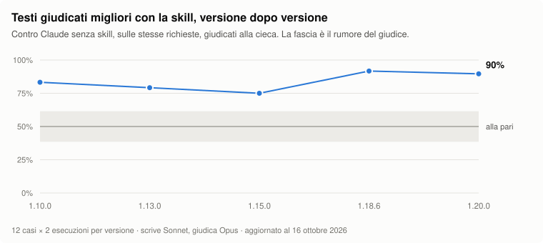

<div align="center">


# Italian master

**Il tuo agente sa già scrivere in italiano.<br>Con Italian master lo scrive come chi lo fa per mestiere.**

Una skill per Claude, Codex e gli altri agenti compatibili con le Agent Skills, costruita su più di cinque milioni di parole italiane lette e misurate.

[](CHANGELOG.md)
[](https://github.com/micheledalsanto/italian-master/actions/workflows/tests.yml)
[](LICENSE)
<br>
[](#claude-code-come-plugin)
[](#codex-e-altri-agenti)
[](#tutti-i-modi-per-installarla)
[](#fonti-e-limiti)
<br>
[](#provala-subito)
[](#il-correttore-da-riga-di-comando)
[](https://github.com/micheledalsanto/italian-master/stargazers)

[Provala subito](#provala-subito) · [La stessa mail, tre volte](#la-stessa-mail-scritta-tre-volte) · [Che cosa sa fare](#chiedile-quello-che-chiederesti-a-un-redattore) · [Messa alla prova](#messa-alla-prova-contro-claude-da-solo) · [Installazione](#tutti-i-modi-per-installarla) · [English](README.en.md)

</div>

*An agent skill (Claude, Codex) for natural Italian writing: grammar, syntax, tone, verb tenses, idioms, headlines. The skill is written in Italian. [Read this README in English](README.en.md).*

## Corretto, eppure finto

Chiedi a un modello linguistico un testo in italiano e riceverai quasi sempre una pagina senza errori che nessun italiano avrebbe scritto. Si apre con un mondo «sempre più connesso», mette tre aggettivi dove ne bastava uno, scrive i titoli con le maiuscole a ogni parola e prende in prestito dall'inglese le lineette lunghe. Se poi gli chiedi di essere più sintetico, il modello cade nel difetto opposto e risponde a frasette di cinque parole chiuse da una battuta, che si riconoscono come generate esattamente come le prime.

Italian master dà al modello quello che un buon redattore impara in anni di mestiere: dove la grammatica si sbaglia davvero, come si costruisce un periodo che non sembri tradotto, quando si dà del tu, del lei o del voi, come si scrive un titolo e quale tempo verbale regge un racconto. Soprattutto, gli insegna a lavorare con i fatti che riceve, senza inventarne altri per riempire la pagina.

## La stessa mail, scritta tre volte

La richiesta è identica per tutti e tre i testi: una mail con cui uno studio professionale comunica ai clienti la chiusura estiva dall'11 al 24 agosto, chiede a chi ha adempimenti in quel periodo di farsi sentire entro il 31 luglio e indica Paola, al cellulare, come riferimento per le urgenze.

**Il modello da solo**

> **Oggetto: Aggiornamento Importante Sulla Nostra Chiusura Estiva**
>
> Gentile Cliente,
>
> speriamo che questa email ti trovi bene! In un periodo dell'anno in cui il riposo diventa fondamentale, desideriamo informarLa che il nostro team si prenderà una meritata pausa — per tornare più carico che mai. Non si tratta solo di una chiusura: è un'occasione per ricaricare le energie, rinnovarci e offrirti un servizio ancora migliore.

**Il modello da solo, quando gli si chiede di essere più sintetico**

> **Oggetto: Ad agosto chiudiamo. Ecco cosa cambia.**
>
> Chiudiamo. Due settimane. Dall'11 al 24 agosto.
>
> Niente panico: le urgenze restano coperte. Il resto può aspettare. A settembre si riparte.

**Il modello con Italian master**

> **Oggetto: Chiusura estiva dello Studio dall'11 al 24 agosto**
>
> Gentili Clienti,
>
> desideriamo informarvi che lo Studio resterà **chiuso per la pausa estiva dall'11 al 24 agosto compresi**. Le attività riprenderanno regolarmente a partire dal **25 agosto**.
>
> Al fine di garantire una corretta gestione delle pratiche e il rispetto delle relative scadenze, invitiamo coloro che hanno adempimenti previsti durante il periodo di chiusura a **contattarci entro il 31 luglio**, così da consentirci di provvedere con il necessario anticipo.
>
> Per eventuali urgenze durante il periodo di chiusura, sarà possibile contattare Paola al numero di cellulare riportato in firma.
>
> Ringraziandovi per la collaborazione, cogliamo l'occasione per augurarvi una serena estate.
>
> **Cordiali saluti,**
>
> Lo Staff dello Studio

Il primo testo passa dal tu al lei nella stessa frase e non contiene nemmeno uno dei dati richiesti. Il secondo riporta le date, ma con il tono di uno slogan, e non dice al cliente che cosa deve fare. Il terzo è la comunicazione che uno studio manda davvero ai suoi clienti, con il registro formale, le date, la scadenza per le pratiche e il contatto per le urgenze.

## Provala subito

Se hai Node 18 o successivo, basta un comando, e non serve clonare la repo:

```bash
npx github:micheledalsanto/italian-master
```

La skill viene copiata in `~/.claude/skills/italian-master`, dove Claude Code la trova da solo. Per Codex aggiungi `--codex`, e quando esce una versione nuova ti basta rilanciare lo stesso comando. Se preferisci il plugin di Claude Code, dentro una sessione scrivi:

```
/plugin marketplace add micheledalsanto/italian-master
/plugin install italian-master@italian-master
```

Le altre strade, da skills.sh a Claude.ai, sono descritte più sotto, in [Tutti i modi per installarla](#tutti-i-modi-per-installarla).

## Misurata su testi veri

Le indicazioni della skill non nascono da un'impressione. Sono state ricavate da testi italiani letti e contati uno per uno, e ogni file di riferimento dice su quali.

| Quanti | Che cosa |
| ---: | --- |
| **oltre 5 milioni** | parole italiane lette e misurate |
| **15.000** | stringhe di interfaccia di otto applicazioni |
| **1.138** | schede prodotto di dieci negozi online |
| **904** | inserzioni a pagamento di 732 inserzionisti |
| **136** | numeri di tredici newsletter |
| **86** | articoli di otto testate online |
| **45** | articoli di nove riviste accademiche |
| **14** | generi di testo, ciascuno con le sue regole |

Quanto è lunga in media una frase di quotidiano, quanti due punti ci sono in un articolo, quali tempi verbali usa un romanzo, come si apre una newsletter: sono misure, e la skill le usa come un redattore usa l'orecchio.

## Messa alla prova contro Claude da solo



Ogni versione della skill viene messa alla prova su dodici richieste fisse, sempre le stesse: una landing page da riscrivere, un sollecito di pagamento, una traduzione, un articolo da scrivere a partire da appunti, una spiegazione per una bambina, l'incipit di un racconto, una guida a un servizio pubblico, i testi di un'interfaccia, una pagina «Chi siamo», una scheda prodotto, una scena e un claim. Ogni richiesta viene eseguita due volte con la skill e due volte senza. Ogni coppia di testi passa poi a una sessione separata di Claude, che non sa quale dei due sia stato scritto con la skill e sceglie il migliore.

| Versione | Testo migliore con la skill | Skill attivata | Formule ogni mille parole |
| --- | ---: | ---: | ---: |
| 1.10.0 | 20 confronti su 24 | 22 sessioni su 24 | 2,0 |
| 1.13.0 | 19 su 24 | 22 su 24 | 1,8 |
| 1.15.0 | 18 su 24 | 22 su 24 | 0,8 |
| 1.18.6 | 22 su 24 | 17 su 24 | 1,6 |
| 1.20.0 | 21 su 24, 1 pari | 22 su 24 | 1,8 |
| Claude senza skill | | | 1,7 |

I numeri dicono alcune cose con sicurezza e altre no.

- **In tutte le versioni misurate il testo scritto con la skill è giudicato migliore in almeno tre confronti su quattro.** Le differenze tra una versione e l'altra, invece, sono troppo piccole per concludere che una versione scriva meglio della precedente. Messo davanti a due testi equivalenti, entrambi di Claude senza skill, il giudice ha dato il 39% anziché il 50%, e la fascia grigia del grafico mostra proprio questo margine.
- **Il vantaggio non sta nelle formule.** Il correttore ne trova poche anche nei testi di Claude senza skill. I giudizi premiano la skill soprattutto perché non inventa fatti, mantiene il registro richiesto e scrive in modo concreto.
- **La skill non si attiva sempre da sola.** Con la versione 1.18.6 si è attivata in 17 sessioni su 24; nelle altre Claude ha scritto senza, e il confronto le ha contate ugualmente. Nella 1.20.0 la descrizione della skill nomina anche narrativa, testi per bambini, claim e pagine «Chi siamo», e le attivazioni sono salite a 22 su 24.
- **Il giudice è un modello linguistico, e i casi sono stati scritti insieme alla skill.** I numeri indicano la direzione del lavoro, ma non sono una misura indipendente della qualità. Le prime versioni (1.0 e 1.5) non compaiono perché le versioni attuali di Claude Code non riescono a caricarle.

Lo script è [`evals/benchmark.py`](evals/benchmark.py), e chiunque può rieseguirlo: le istruzioni sono in [`CONTRIBUTING.md`](CONTRIBUTING.md).

## Che cosa la rende diversa

- **Regole diverse per ogni genere.** Una mail a un cliente, la home di un sito, il messaggio di errore di un'app, un articolo e un racconto chiedono cose diverse. Le contrapposizioni a effetto e le serie di tre aggettivi, che in un articolo sono difetti, in un claim funzionano benissimo, e la skill lo sa: distingue caso per caso e conosce i falsi allarmi.
- **Nessun fatto inventato.** Numeri, nomi, citazioni e dettagli verosimili non vengono aggiunti per dare colore. Se i dati sono pochi, il testo esce più breve e in fondo la skill indica che cosa manca.
- **Due difetti da evitare.** Accanto allo slop enfatico, carico di aggettivi, c'è quello sintetico, fatto di frasette e di sentenze, che nasce proprio dal tentativo di evitare il primo. La skill li riconosce entrambi.
- **Il registro di chi firma.** Uno studio, un'azienda o un ente scrivono in modo formale e completo, e la skill non confonde l'informalità con la naturalezza.
- **La tua voce.** Se le dai da leggere i tuoi testi, ne ricava una scheda di stile con le misure e scrive i prossimi come li scriveresti tu.

## Chiedile quello che chiederesti a un redattore

Non serve invocarla, perché si attiva da sola ogni volta che chiedi un testo in italiano. Qualche esempio:

- «Riscrivi questa pagina "Chi siamo", suona finta.»
- «Dammi dieci titoli per questo articolo, niente clickbait.»
- «Scrivi una mail di sollecito all'architetto Ferraris, ci diamo del lei.»
- «Scrivi la hero section della home: siamo una falegnameria di Udine, facciamo mobili su misura dal 1961.»
- «Trovami un claim per il lancio di questo prodotto, con un gioco di parole sul nome.»
- «Correggi solo gli errori, non toccare lo stile.»
- «Traduci questo post in italiano, non deve sembrare una traduzione.»
- «Leggi questi tre numeri della mia newsletter e scrivi il prossimo con la stessa voce.»

In Claude Code puoi anche richiamarla in modo esplicito, con `/italian-master:italian-master` se l'hai installata come plugin e con `/italian-master` se l'hai copiata a mano. In Codex si richiama con `$italian-master`.

Per i lavori più lunghi il plugin aggiunge tre comandi:

| Comando | Che cosa fa |
| --- | --- |
| `/italian-master:rivedi` | Rivede un file o un testo incollato e spiega che cosa ha cambiato |
| `/italian-master:voce` | Ricava dai testi di un autore la sua scheda di stile, con le misure, e la confronta con una bozza |
| `/italian-master:configura` | Crea o aggiorna, con poche domande, il file del tono e del pubblico |

### Quattordici generi, ognuno con le sue regole

Ogni genere ha un file di riferimento, con le misure prese sui testi di quel genere. L'agente legge sempre [`SKILL.md`](skills/italian-master/SKILL.md) e apre gli altri file solo quando gli servono, così il contesto resta leggero.

| Che cosa scrivi | Su che cosa è misurato | Dove sta |
| --- | --- | --- |
| Email, avvisi, lettere a clienti e fornitori | circa cinquanta comunicazioni formali | [`corrispondenza-formale`](skills/italian-master/references/corrispondenza-formale.md), [`registri`](skills/italian-master/references/registri.md) |
| Home, claim, giochi di parole, «Chi siamo», pagine di servizio | dieci siti di aziende ed enti, dodici di agenzie | [`giochi-di-parole`](skills/italian-master/references/giochi-di-parole.md), [`siti`](skills/italian-master/references/siti.md), [`agenzie-digitali`](skills/italian-master/references/agenzie-digitali.md) |
| Schede prodotto | 1.138 schede di dieci negozi online | [`schede-prodotto`](skills/italian-master/references/schede-prodotto.md) |
| Annunci a pagamento | 904 inserzioni di 732 inserzionisti | [`annunci`](skills/italian-master/references/annunci.md) |
| Newsletter | 136 numeri di tredici newsletter | [`newsletter`](skills/italian-master/references/newsletter.md) |
| Articoli, post, guide, titoli | ottantasei articoli di otto testate, sessantuno pagine di tredici siti | [`periodo`](skills/italian-master/references/periodo.md), [`connettivi`](skills/italian-master/references/connettivi.md), [`attacchi-e-chiusure`](skills/italian-master/references/attacchi-e-chiusure.md), [`titoli`](skills/italian-master/references/titoli.md), [`testi-per-la-ricerca`](skills/italian-master/references/testi-per-la-ricerca.md), [`descrivere-e-raccontare`](skills/italian-master/references/descrivere-e-raccontare.md) |
| Spiegazioni per chi non è del mestiere, e per i bambini | dodici siti che spiegano o accompagnano, lezioni scritte per un bambino di otto anni, una rivista di scienza per ragazzi | [`tono-accogliente`](skills/italian-master/references/tono-accogliente.md), [`scrivere-per-bambini`](skills/italian-master/references/scrivere-per-bambini.md) |
| Testi di un'interfaccia | quindicimila stringhe di otto applicazioni | [`microcopy`](skills/italian-master/references/microcopy.md) |
| Racconti | venti romanzi per dialogo e scena, ventidue libri per i tempi verbali, ventisei racconti e quattro raccolte di fiabe | [`narrativa`](skills/italian-master/references/narrativa.md), [`narrativa-fantastica`](skills/italian-master/references/narrativa-fantastica.md), [`tempi-verbali`](skills/italian-master/references/tempi-verbali.md), [`modelli`](skills/italian-master/references/modelli.md) |
| Tesi, saggi, articoli accademici | quarantacinque articoli di nove riviste | [`scrittura-accademica`](skills/italian-master/references/scrittura-accademica.md) |
| Traduzioni verso l'italiano | elenchi di calchi, falsi amici e modi di dire | [`calchi`](skills/italian-master/references/calchi.md), [`modi-di-dire`](skills/italian-master/references/modi-di-dire.md) |
| Revisioni e correzioni di bozze | le risposte della Crusca e di Treccani, e testi generati per il confronto | [`ai-slop`](skills/italian-master/references/ai-slop.md), [`slop-asciutto`](skills/italian-master/references/slop-asciutto.md), [`impronte`](skills/italian-master/references/impronte.md), [`grammatica`](skills/italian-master/references/grammatica.md), [`punteggiatura-tipografia`](skills/italian-master/references/punteggiatura-tipografia.md), [`sintassi-stile`](skills/italian-master/references/sintassi-stile.md) |
| Testi con la tua voce e il tuo tono | i testi che le dai da leggere | [`imparare-una-voce`](skills/italian-master/references/imparare-una-voce.md), [`tono-e-pubblico`](skills/italian-master/references/tono-e-pubblico.md) |
| Testi che devono convincere, e idee da trovare | studi di psicologia della lettura, della persuasione e della creatività, con l'esito delle repliche | [`mente-del-lettore`](skills/italian-master/references/mente-del-lettore.md), [`persuasione`](skills/italian-master/references/persuasione.md), [`tecniche-creative`](skills/italian-master/references/tecniche-creative.md) |

## Tutti i modi per installarla

### Con npx

È il modo più rapido, perché non richiede di clonare la repo. Serve Node 18 o successivo.

```bash
npx github:micheledalsanto/italian-master
```

Il comando copia la skill in `~/.claude/skills/italian-master`, dove Claude Code la trova da solo, e se lo rilanci la aggiorna. Le opzioni sono queste:

```bash
npx github:micheledalsanto/italian-master --codex     # per Codex (~/.agents/skills)
npx github:micheledalsanto/italian-master --tutti     # per Claude Code e per Codex
npx github:micheledalsanto/italian-master --project   # solo nel progetto corrente (.claude/skills, o .agents/skills con --codex)
npx github:micheledalsanto/italian-master rimuovi     # la disinstalla
npx github:micheledalsanto/italian-master --help      # tutte le opzioni
```

### Con skills.sh

Se usi il comando `skills` di [skills.sh](https://skills.sh), che installa le skill da GitHub per Claude Code, Codex, Cursor e altri agenti, ti basta scrivere:

```bash
npx skills add micheledalsanto/italian-master
```

### Claude Code, come plugin

Dentro una sessione di Claude Code:

```
/plugin marketplace add micheledalsanto/italian-master
/plugin install italian-master@italian-master
```

Oppure dal terminale:

```bash
claude plugin marketplace add micheledalsanto/italian-master
claude plugin install italian-master@italian-master
```

Per installarla da una copia locale della repo, senza passare da GitHub, al posto di `micheledalsanto/italian-master` indica il percorso della cartella:

```bash
claude plugin marketplace add ./italian-master
claude plugin install italian-master@italian-master
```

Per provarla in una sola sessione, senza installarla, c'è `claude --plugin-dir ./italian-master`.

### Claude Code, a mano

Copia la cartella della skill tra le tue skill personali:

```bash
git clone https://github.com/micheledalsanto/italian-master.git
cp -r italian-master/skills/italian-master ~/.claude/skills/
```

Se ti serve solo in un progetto, copiala in `.claude/skills/` dentro quel progetto.

### Codex e altri agenti

Codex cerca le skill nella cartella `.agents/skills`, sia nel progetto sia nella home. Con npx:

```bash
npx github:micheledalsanto/italian-master --codex             # ~/.agents/skills/italian-master
npx github:micheledalsanto/italian-master --codex --project   # ./.agents/skills/italian-master
```

Oppure a mano:

```bash
git clone https://github.com/micheledalsanto/italian-master.git
mkdir -p ~/.agents/skills && cp -r italian-master/skills/italian-master ~/.agents/skills/
```

Poi riavvia Codex. La skill si attiva da sola quando chiedi un testo in italiano, e puoi richiamarla in modo esplicito con `$italian-master` oppure da `/skills`. La cartella `.agents/skills` è letta anche dagli altri agenti che seguono lo stesso formato, e se te ne serve una diversa c'è l'opzione `--dir`.

### Claude.ai e app desktop

1. Scarica la repo e crea uno zip della cartella `skills/italian-master` (lo zip deve contenere la cartella `italian-master` con dentro `SKILL.md`).
2. In Claude apri le impostazioni, vai alla sezione delle skill e carica lo zip.

## Tono e pubblico, decisi da te

Per chi scrivi e con quale tono lo decidi tu, una volta sola, in un file di configurazione che la skill legge prima di scrivere.

```bash
npx github:micheledalsanto/italian-master configura            # per tutti i tuoi progetti (~/.claude/italian-master.md)
npx github:micheledalsanto/italian-master configura --project  # solo per il progetto corrente (.claude/italian-master.md)
npx github:micheledalsanto/italian-master configura --codex    # per Codex (~/.agents/italian-master.md)
```

Il comando crea un modello da compilare con le voci che seguono. Quelle che lasci vuote, la skill le ricava dal contesto della richiesta.

| Voce | Che cosa ci scrivi |
| --- | --- |
| Pubblico | Chi legge e quanto ne sa: esperti, persone del settore ma non tecniche, non esperti, pubblico misto, bambini (con l'età) |
| Tono | Formale, cordiale, accogliente, giornalistico, tecnico o commerciale, oppure una descrizione tua |
| Persona | Tu, lei o voi per il lettore; noi, io o la forma impersonale per chi scrive |
| Lingua | Quanto inglese ammettere, quali parole usare e quali evitare |
| Testi di riferimento | I testi da cui la skill deve imparare la tua voce |
| Tipi di testo | Le eccezioni, per esempio «newsletter: accogliente, tu» oppure «comunicazioni ai clienti: formale, voi» |

Quello che chiedi in una singola richiesta prevale sulla configurazione, e se esistono sia il file del progetto sia quello personale vale il primo. Il file sta fuori dalla cartella della skill, per cui gli aggiornamenti non lo toccano. Se hai installato la skill a mano o su Claude.ai, copia il modello da [`assets/italian-master.md`](skills/italian-master/assets/italian-master.md), oppure incolla le tue scelte nelle istruzioni del progetto.

## Il correttore da riga di comando

`controlla.py` cerca in un testo le formule fatte, gli errori e i segnali tipografici più comuni, e ne misura il ritmo (parole per frase, frasi brevi, periodi lunghi, virgole, due punti) confrontandolo con quello di giornali e riviste. Calcola anche l'indice di leggibilità Gulpease. Usa solo la libreria standard e richiede Python 3.8 o successivo.

```bash
python skills/italian-master/scripts/controlla.py bozza.md
```

```
== bozza.md ==
63 parole, 5 frasi

Falso contrasto (1)
  riga   5  …r tornare più carico che mai. Non si tratta solo di una chiusura: è un'occasio…
            → scrivi la parte affermativa

Calchi dall'inglese (1)
  riga   5  speriamo che questa email ti trovi bene! In un periodo dell'anno in c…
            → togli

Tipografia (2)
  riga   5  …i prenderà una meritata pausa — per tornare più carico che ma…
            → lineetta lunga all'inglese: prova virgole, due punti o parentesi; se resta, « – » con gli spazi
  riga   1  Aggiornamento Importante Sulla Nostra Chiusura Estiva
            → maiuscole a ogni parola: in italiano solo la prima e i nomi propri

4 segnalazioni (63 ogni mille parole). Sono indizi: decide chi scrive.
```

Tra le opzioni ci sono `--json` per avere un'uscita strutturata, `--strict` per uscire con codice 1 quando ci sono segnalazioni (utile in una pipeline) e `--bambini` per i testi destinati ai bambini, nei quali le frasi corte sono giuste e conta la leggibilità.

Lo stesso script sa anche misurare la voce di un autore. Se gli dai tre o più testi della stessa persona, stampa una scheda con la persona di chi scrive e quella del lettore, la lunghezza delle frasi e dei capoversi, la punteggiatura, i connettivi preferiti e quelli che non usa mai, le parole che tornano. Con `--confronta` indica in quali misure una bozza si allontana da quella voce.

```bash
python skills/italian-master/scripts/controlla.py --voce post1.md post2.md post3.md --confronta bozza.md
```

Lo script non riconosce i testi generati e non si accorge dei fatti inventati. Segnala le abitudini di scrittura deboli, chiunque le abbia, e anche un testo senza segnalazioni può essere mediocre.

## Fonti e limiti

Per la norma la skill segue l'Accademia della Crusca e Treccani, per lo stile la tradizione italiana della scrittura chiara (Calvino, Eco, Serianni, Sabatini, Castellani Pollidori, Carrada). Le misure vengono da più di cinque milioni di parole lette e contate: articoli di otto testate italiane online, dieci siti di aziende ed enti, dodici siti di agenzie digitali, tredici newsletter, le schede prodotto di dieci negozi online, novecento inserzioni, le stringhe di otto applicazioni, articoli di riviste accademiche, racconti fantastici, testi per i bambini, lettere, saggi, fiabe, romanzi, memorie, teatro e altre opere di pubblico dominio. Molte indicazioni sul registro e sui testi di presentazione vengono invece dalle correzioni di un lettore madrelingua, raccolte anche in confronti alla cieca tra i testi scritti con la skill e quelli del modello senza skill. Le indicazioni su come legge chi legge, su come si convince e su come si trovano le idee vengono da studi di psicologia e di linguistica, scelti tra quelli che hanno retto alle repliche. L'elenco completo è in [`fonti.md`](skills/italian-master/references/fonti.md).

La skill non contiene testi altrui. Giornali e siti non sono nominati e nessuna loro frase è riportata, perché gli esempi sono scritti apposta, con fatti inventati. Le sole citazioni testuali sono brevi passi di opere uscite prima del 1930.

La skill ha anche alcuni limiti, che conviene conoscere prima di usarla.

- **Riguarda l'italiano d'Italia.** L'italiano della Svizzera e le varietà regionali compaiono soltanto in qualche indicazione puntuale.
- **Segue una lingua che cambia.** Un calco che oggi conviene evitare potrebbe entrare domani nei dizionari. Dove l'uso non è ancora stabile, la skill lo segnala anziché correggere.
- **Insegue un bersaglio mobile.** I segnali dei testi generati cambiano insieme ai modelli, e il catalogo delle formule va aggiornato con regolarità. È uno dei motivi per cui la repo è pubblica e accoglie volentieri le segnalazioni.
- **Lavora sui fatti che riceve.** La skill non aggiunge dati per allungare un testo: se la richiesta ne contiene pochi, il testo resta breve, e in fondo è indicato quali informazioni servirebbero per completarlo.

## Contribuire, versioni, licenza

Segnalazioni, correzioni e nuovi esempi sono i benvenuti, e le indicazioni per proporli sono in [`CONTRIBUTING.md`](CONTRIBUTING.md). Se la skill ti è utile, una stella alla repo aiuta altre persone a trovarla.

La versione corrente è la 1.20.0. Le modifiche sono elencate nel [CHANGELOG](CHANGELOG.md).

La licenza è la [MIT](LICENSE). Italian master è ideata e curata da [Michele Dal Santo](https://www.micheledalsanto.it).
